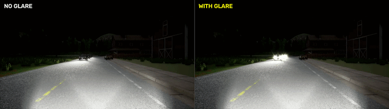
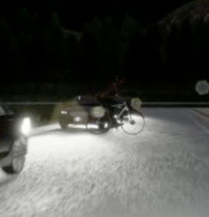
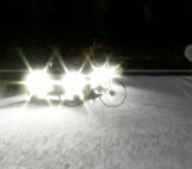
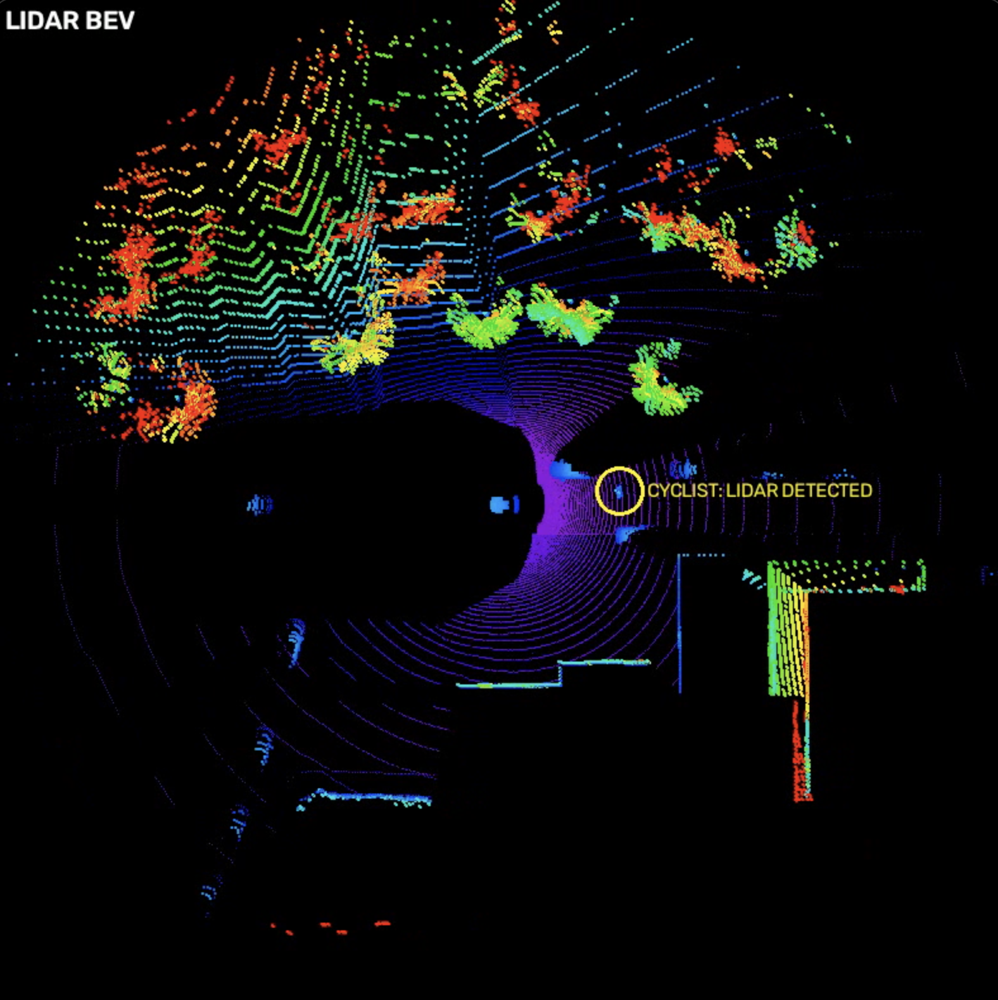
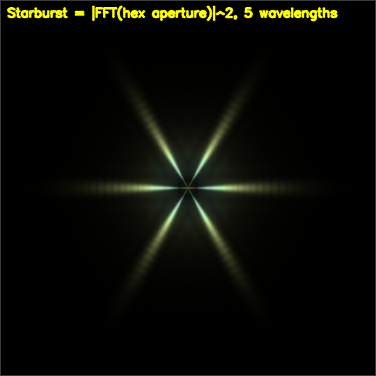
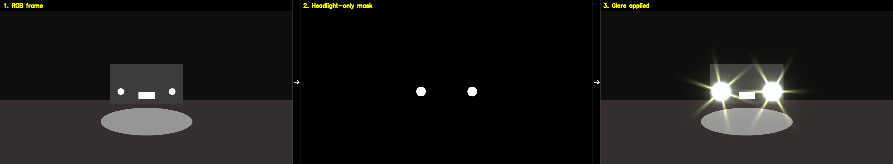
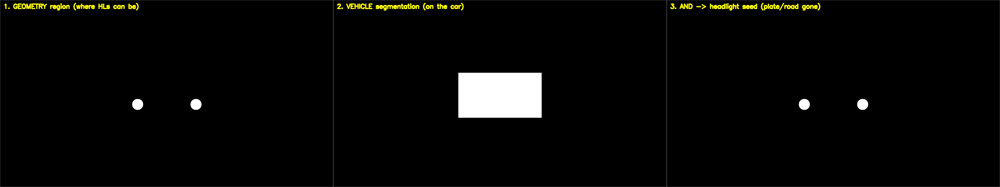

# Headlight Glare Simulation for CARLA Night Scenes

A physically-motivated model of oncoming-headlight glare in CARLA, built to study
a specific question: **when glare destroys the camera evidence for a road user,
is that loss detectable?**

The scenario is a night drive with no street lighting. Oncoming traffic runs low
and high beams. A cyclist enters the ego's lane at a fixed time, positioned so
that in *image space* it falls inside the glare of the nearest oncoming car -
while the LIDAR still returns it plainly.



## Results

From a single 45 s run. Contrast is the absolute difference in mean luminance
(0–255) between the cyclist's pixels and a ring of background around it, measured
on the same frame with and without glare.

| Measure | Value |
|---|---|
| Cyclist on screen | 40 frames, 2.05 s – 4.75 s |
| Mean contrast, no glare → with glare | 19.4 → 14.2 (**27% lost**) |
| Worst frame, no glare → with glare | 45.6 → 6.5 (**86% lost**) |
| LIDAR | Cyclist detected while the camera loses it |

The mean is taken over every frame the cyclist is measurable, including frames
where it is only partly inside the glare. The worst frame is the moment it is
most buried, and is the clearer picture of what glare does to the camera.

<table>
  <tr>
    <th>No glare</th>
    <th>With glare</th>
  </tr>
  <tr>
    <td></td>
    <td></td>
  </tr>
</table>

The LIDAR is unaffected. At the same moment, the cyclist (ringed) is returned
plainly in the point cloud:



## Why this isn't a blur filter

Glare here is composited from four optical layers, each with a physical basis:

| Layer | What it models |
|---|---|
| **core** | sensor saturation at the source |
| **bloom** | multi-scale soft halo |
| **star** | far-field diffraction pattern of the lens aperture |
| **veil** | broad, low-amplitude haze that lifts the local black level |

The starburst is not drawn. It is computed as the power spectrum of the aperture
shape - the far-field diffraction pattern of a point source seen through an
aperture, following [Hullin et al. (2011), *Physically-Based Real-Time Lens Flare
Rendering*](https://resources.mpi-inf.mpg.de/lensflareRendering/), sec. 7.1.2.
That pattern is then sampled at five wavelengths, each scaled radially by
wavelength, which is what produces genuine chromatic dispersion in the rays
rather than a tinted overlay.



The **veil** is the layer that matters for the research question. It is what
actually occludes a road user: objects beside a bright light lose contrast
against their background rather than being covered up. That distinction is why
the pipeline measures contrast loss rather than pixel coverage.

The pipeline end to end, illustrated on a synthetic scene: RGB frame, headlight-only
mask, glare applied. Note the licence plate and the light pool on the road are
bright too, but never become glare sources.



## The detection gate

A naive implementation produces *ghost glare* - flares drawn for cars that are
behind buildings or off the map entirely. Projecting a headlight tells you where
it *would* land, not whether the camera can see it.

Segmentation alone does not fix this. It labels a pixel "vehicle" but cannot say
*which* vehicle, so a hidden car's headlight landing on a nearer car's silhouette
passes a segmentation-only test.

Depth resolves it. A vehicle may emit glare only once enough pixels inside its
projected 3D bounding box are **both** labelled vehicle **and** at that vehicle's
own depth. Headlight positions themselves come from bounding-box geometry, not
from brightness thresholding.

Illustrated on a synthetic scene: the geometry region says where headlights *can*
be, segmentation confirms they are on a vehicle, and only their intersection seeds
the glare. Bright pixels that are not headlights (the plate, the road) drop out.



Every vehicle is given a verdict on every frame - `detected`, `not_detected`,
`off_camera`, `too_far`, `facing_away`, `headlights_hidden` - so any flare in the
output can be traced to the reason it was allowed. Over the same run:

| Verdict | Vehicle-frames |
|---|---|
| `detected` (allowed to glare) | 897 |
| `facing_away` | 45,837 |
| `off_camera` | 11,057 |
| `too_far` | 4,048 |
| `not_detected` | 146 |
| `headlights_hidden` | 46 |

Of 62,031 vehicle-frame checks, 1.4% were allowed to glare, an average of 1.7
glaring headlights per frame. The rejected cars are exactly the ones a naive
projection would have drawn ghost glare for.

## Outputs

Running `Carla_script.py` writes to `exports/`:

- `ego_first_person_compare.mp4` - side-by-side, no glare vs. with glare
- `ego_first_person_glare.mp4` - first-person view with glare composited
- `ego_first_person.mp4`, `ego_third_person.mp4` - clean reference views
- `lidar_bev.mp4` - LIDAR bird's-eye view, with the cyclist ringed and marked
  when the LIDAR detects it
- `diag_obstacle_occlusion.png` - the worst-case frame, cropped, before and after

Two results are logged for the central claim: the mean contrast between the
cyclist and its local background with and without glare (the camera half), and
how many scans detected the cyclist while it was in LIDAR range (the LIDAR half).
A scan counts as a detection only if it has returns on the cyclist that sit above
the local ground and are not the ego's own bodywork.

### Debug outputs

The detection gate has its own instrumentation, off by default. Run with the
`DEBUG` environment variable set to additionally write per-vehicle gate-verdict
overlays, projection checks, and raw RGB/segmentation dumps:

```bash
DEBUG=1 python3 Carla_script.py
```

This adds `diag_projection_early*.png` (every vehicle annotated with the gate's
verdict and why it was or wasn't allowed to glare), `diag_projection.png`,
`diag_rgb.png`, and `diag_seg_labels.png`. These were the main tool for verifying
that only cars the camera genuinely resolves produce glare.

## Install and run

```bash
pip install -r requirements.txt
```

The figure scripts need nothing else:

```bash
python3 make_slide_figures.py      # -> slide_figures/
python3 glare_pipeline_figure.py
python3 glare_layers_figure.py
```

`Carla_script.py` additionally needs the `carla` Python API from your simulator
build and a running server:

```bash
./CarlaUE4.sh                      # in the CARLA directory
python3 Carla_script.py
```

`spawn_points.py` draws numbered spawn-point markers in the spectator view - use
it to pick the ego and destination indices.

## Repository layout

| File | Purpose |
|---|---|
| `glare_mask.py` | Headlight localization, detection gate, glare rendering |
| `Carla_script.py` | Scenario setup, sensors, run loop, exports |
| `spawn_points.py` | Spawn-point visualizer |
| `make_slide_figures.py` | Generates all six presentation figures |
| `glare_pipeline_figure.py`, `glare_layers_figure.py` | Standalone figures |
| `seg_snapshot.py` | Captures a real RGB + segmentation frame pair |
| `media/` | README images and the comparison loop |

Note that the underscore-prefixed layer functions in `glare_mask.py`
(`_draw_star_flares`, `_radial_halo`, `_veiling_glare`, `_build_spectral_star`,
`_headlight_centers`) are imported directly by the figure scripts. Their
signatures are effectively public.

## Limitations

Stated plainly, because they bound what the results can claim.

**Glare is applied in post, not in the loop (in progress).** In this repository
the ego drives under CARLA's Traffic Manager on clean frames, and glare is
composited afterward from recorded RGB, segmentation, depth and vehicle geometry.
So the results above measure *how much camera evidence glare destroys*, not how a
policy behaves when driving through it.

Work under way moves the glare into the loop: applying it live to every camera
frame an end-to-end driving model receives, so the glare changes the model's
predicted waypoints and its steering and braking. The target is DeepSight, a
camera-only vision-language planner, evaluated on Bench2Drive overtaking scenarios
at night. The glare is injected in the agent's `tick()`, before the frames are
written to disk, so it reaches both the current surround views and the history
frames the model reads back. That code is not in this repository yet.

**Physically motivated, not photometrically calibrated.** The aperture
diffraction model and wavelength scaling are principled, but nothing here has
been fitted against captures from a real lens and sensor. Absolute intensities
and the dispersion profile are plausible, not measured.

**Headlights only.** Discrete point sources whose 3D positions are recoverable
from bounding-box geometry. Sun glare is a single source with different optics
and no occlusion structure; fog and airborne dust are volumetric scattering, a
different model entirely. Neither is covered.

**Semantic tags are version-dependent.** `VEHICLE_TAG = 14` and the
pedestrian/rider/bicycle constants assume the Cityscapes-aligned CARLA palette
(0.9.14 / 0.9.15). Verify with `np.unique()` on a frame containing a visible car
before trusting results on another build.

**Privileged information is used for rendering and labelling only.** Depth and
segmentation drive the corruption model and the ground truth. In the closed-loop
work they feed only the glare renderer; the driving model still sees camera
images alone.

## License

MIT - see [LICENSE](LICENSE).
